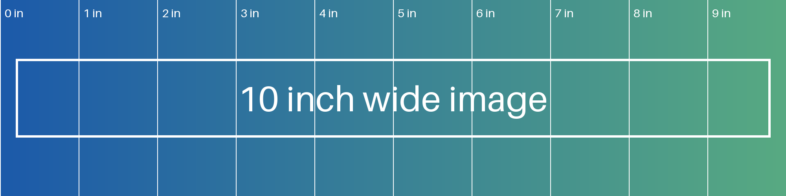

# Content Wider than the Page

This document has an HTML table with a fixed width of 14 inches, about twice the content area of the page. By default the converter does not scale the content down to such a table, so the right part of the table is cut off at the margin. With the Fit Wide Content to Page option the whole content is scaled down until the table fits the page.

## A table wider than the page

Markdown allows HTML blocks, and the table below has a fixed width of 14 inches; its last columns are cut off unless the content is scaled down to fit the page.

<table style="width: 14in; table-layout: fixed; border-collapse: collapse; border: 1px solid #808080">
<thead><tr style="background: #D9E2F3"><th style="width: 1.94in; text-align: left">Part number</th><th style="width: 2.81in; text-align: left">Supplier reference</th><th style="width: 3.22in; text-align: left">Warehouse location</th><th style="width: 0.87in; text-align: left">Quantity</th><th style="width: 0.94in; text-align: left">Unit price</th><th style="width: 4.22in; text-align: left">Catalogue address</th></tr></thead>
<tbody><tr><td>HVX_2026_000138_REV_A</td><td>SUP_NORTH_INDUSTRIAL_PUMPS_0001</td><td>EU_DE_HAMBURG_HALL_7_RACK_12_SHELF_3</td><td>12</td><td>1,840.00</td><td>https://catalog.example.com/parts/HVX_2026_000138_REV_A</td></tr><tr><td>HVX_2026_000212_REV_C</td><td>SUP_SOUTH_CONTROL_VALVES_0417</td><td>EU_FR_LYON_HALL_2_RACK_04_SHELF_1</td><td>48</td><td>236.50</td><td>https://catalog.example.com/parts/HVX_2026_000212_REV_C</td></tr><tr><td>CMP_2025_004471_REV_B</td><td>SUP_EAST_COMPRESSORS_0098</td><td>EU_PL_POZNAN_HALL_1_RACK_09_SHELF_6</td><td>3</td><td>12,950.00</td><td>https://catalog.example.com/parts/CMP_2025_004471_REV_B</td></tr><tr><td>SPR_2026_010933_REV_A</td><td>SUP_WEST_SPARE_PARTS_2210</td><td>EU_ES_VALENCIA_HALL_3_RACK_01_SHELF_2</td><td>250</td><td>18.75</td><td>https://catalog.example.com/parts/SPR_2026_010933_REV_A</td></tr></tbody>
</table>

## A 10 inch wide image

Images are reduced to the width of the page on their own, so the image below fits the page whether the option is set or not.



## A long code line

Code lines are wrapped on their own as well:

```csharp
var document = PdfDocumentFactory.CreateDocumentWithAllOptionsConfigured(pageSize: PdfPageSize.A4, orientation: PdfPageOrientation.Portrait, margins: new PdfMargins(36, 36, 36, 36), compression: true, outline: true);
```

## A Markdown table

Markdown tables take the width of the page:

| Identifier | Description | Value | Notes |
|---|---|---|---|
| `PdfDocumentFactory.CreateDocumentWithAllOptionsConfigured` | Creates a document with every option set from the start | `PdfPageSize.A4` | Long identifiers are broken between letters when needed |
| `ConversionSettings.MaximumConcurrentRenderingProcesses` | The number of rendering processes running at the same time | 4 | Applies to the whole application |

## Regular content

The rest of the document is regular text that fits the page. The quick brown fox jumps over the lazy dog. The quick brown fox jumps over the lazy dog.
